<!--
  VENU2328 · PROFILE README
  Every image in /assets is generated by tools/build_assets.py from one content
  config + one design system. Edit the config there and rebuild — don't hand-edit SVGs.
-->


 

 

| 🎮 &nbsp;**CHOOSE YOUR SIDE QUEST** | |
|:--|:--|
| 🎓 &nbsp;Student prepping for JEE · NEET · CUET | **[Try SciPhyLabs →](https://sciphylabs.com)** |
| 🏫 &nbsp;School, coaching centre or institution | **[Talk partnerships →](mailto:sreeram23db@gmail.com?subject=SciPhyLabs%20for%20our%20institution)** |
| 🔬 &nbsp;Researcher or reviewer | **[Read the white paper →](https://sreeramvenugopal.com/Research-Whitepaper.pdf)** |
| 💻 &nbsp;Developer | **[Browse the repos →](#work)** |

 

<!-- ═══════════════════════════════════════════════ 01 ABOUT -->


### I'm Sreeram — founder, student and researcher from Puducherry, India.

I started building **[SciPhyLabs](https://sciphylabs.com)** at 15 because physics deserves better than another PDF. Today it's **400+ interactive simulations**, notes, formulas and PYQs for Class 11–12, JEE, NEET and beyond — built for schools and coaching centres.

I live where science, software and storytelling overlap: turning hard ideas into things you can *play with*, then researching and writing about why that matters.


<b>↳ open the lab notebook</b> &nbsp;5 facts · zero fluff

 

- **01** — Started SciPhyLabs at 15, in 2023.
- **02** — 400+ simulations and counting — every one is a physics concept you can poke at.
- **03** — Writing two books at once: *Physics Masterbook* (Grade 11 & 12) and *The G.O.A.T. Series*.
- **04** — Debater and keynote speaker when I'm away from the keyboard.
- **05** — Published a white paper on which Indian schools virtual labs can't reach (preprint, Sept 2026).

 

<!-- ═══════════════════════════════════════════════ 02 WORK -->


<a href="https://sciphylabs.com"></a>

<a href="https://github.com/Venu2328/SciPhyLabs2026"></a>
<a href="https://github.com/Venu2328/SreeramVenugopal"></a>

<b>↳ for schools, coaching centres & institutions</b>

 

SciPhyLabs is licensed to institutions rather than sold to individual students — simulations, chapter notes, formulas, derivations and previous-year questions in one place, ready for the classroom.

**[Request a demo or partnership →](mailto:sreeram23db@gmail.com?subject=SciPhyLabs%20for%20our%20institution)**

 

<!-- ═══════════════════════════════════════════════ 03 RESEARCH -->


<a href="https://sreeramvenugopal.com/Research-Whitepaper.pdf"></a>

- 📄 &nbsp;**White paper** — [*Where Virtual Laboratories Cannot Reach*](https://sreeramvenugopal.com/Research-Whitepaper.pdf) · preprint, peer review pending
- 📚 &nbsp;**Books in progress** — *Physics Masterbook* (Grade 11 & 12) · *The G.O.A.T. Series*
- ✍️ &nbsp;**On Medium** — [The Future of JEE Preparation Isn't More PDFs](https://medium.com/@sreeram23db/the-future-of-jee-preparation-isnt-more-pdfs-9d9ebb755315) · [SciPhyLabs — The Revolution of the Decade](https://medium.com/@sreeram23db/sciphylabs-the-revolution-of-the-decade-072293126ec7)
- 🆔 &nbsp;**ORCID** — [0009-0009-2916-7633](https://orcid.org/0009-0009-2916-7633)
- 🗄️ &nbsp;**Zenodo** — [10.5281/zenodo.20113496](https://doi.org/10.5281/zenodo.20113496) · archived release of this profile

 

<!-- ═══════════════════════════════════════════════ 04 TOOLBOX -->


<b>CURRENTLY NERDING OUT ON ↓</b>


 

<!-- ═══════════════════════════════════════════════ 05 SIGNAL -->

<picture>
  <source media="(prefers-color-scheme: dark)" srcset="https://raw.githubusercontent.com/Venu2328/Venu2328/output/snake-dark.svg">
  <source media="(prefers-color-scheme: light)" srcset="https://raw.githubusercontent.com/Venu2328/Venu2328/output/snake.svg">
  
</picture>

<b>↳ nerd stats</b> &nbsp;live · public contributions only

 

 

<!-- ═══════════════════════════════════════════════ 06 CONNECT -->

**Building something in science, education or AI? Want SciPhyLabs in your school?** 
My inbox is open — I reply faster than you can say *projectile motion*.

  

 


<a href="#top"><b>↑ BACK TO THE POSTER</b></a>

